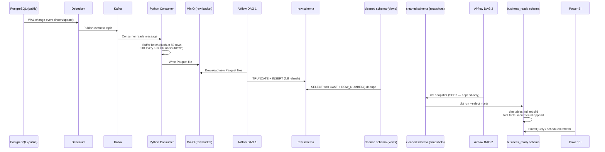
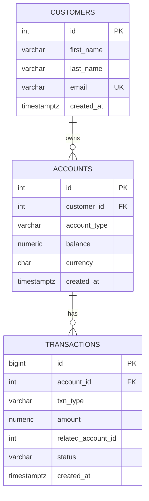
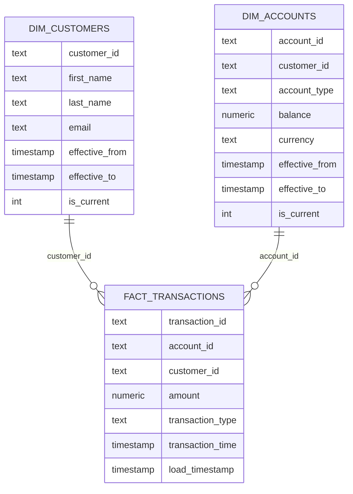

# 🏦 Real-Time Banking Data Pipeline

### An End-to-End Data Engineering Portfolio Project — CDC Streaming, Layered Warehousing, SCD Type 2 History, and CI/CD to a Cloud Warehouse

<p align="left">
  
  
  
  
  
  
  
  
  
  
  
</p>

---

## 1. Project Title

**Real-Time Banking Data Pipeline** — a self-contained, containerised data platform simulating how a modern retail bank ingests, streams, transforms, and serves transactional data for analytics, built with an emphasis on production-realistic patterns (Change Data Capture, layered warehousing, Slowly Changing Dimensions, and automated CI/CD) rather than a toy ETL script.

> **Note on scope:** This project deliberately substitutes Snowflake (used in the original reference course this project was inspired by) with **PostgreSQL** throughout, as a cost-conscious architectural decision. Every core data engineering concept — CDC, layered warehousing, SCD2, orchestration, CI/CD — is preserved and implemented in full; only the specific warehouse *product* changed. This substitution, and the reasoning behind it, is discussed explicitly in [Section 13](#13-engineering-decisions).

---

## 2. Executive Summary

This project implements a **real-time, event-driven data pipeline** for a simulated retail banking environment. It captures live transactional data (customers, accounts, transactions) the moment it changes at the source, streams those changes through a distributed message broker, lands them in object storage, and orchestrates their transformation through a layered warehouse architecture — ultimately producing clean, historically-accurate, business-ready dimensional and fact tables for reporting in Power BI.

**What it does:** Continuously captures banking transactions and account changes from a PostgreSQL source database, streams them via Kafka/Debezium, stages them in an S3-compatible data lake (MinIO), and transforms them through Airflow-orchestrated dbt models into a dimensional warehouse — while preserving full historical lineage of every customer and account change using Slowly Changing Dimension Type 2 (SCD2).

**Why it exists:** To demonstrate, hands-on, the full lifecycle of a modern data engineering pipeline — not just "move data from A to B," but the harder, more realistic problems: change data capture without polling, idempotent batch loading, historical data preservation, data quality testing, and automated deployment validation via CI/CD against a real cloud database.

**What problem it solves:** In a banking context, business stakeholders (Credit Risk, Finance, Reporting teams) need to know not just *what a customer's data looks like today*, but *what it looked like at any point in time* — for audit, reconciliation, and regulatory purposes. A naive pipeline that simply overwrites records on update loses this history entirely. This project's core engineering focus is solving that problem correctly, at the warehouse layer, using industry-standard SCD2 patterns — while remaining fully reproducible on a single developer machine via Docker.

---

## 3. Business Context

Retail banks operate core banking systems that process a continuous stream of transactions — deposits, withdrawals, transfers — alongside slower-moving reference data such as customer and account records. Two business realities drive this project's design:

- **Downstream teams (Risk, Finance, Regulatory Reporting) need historically accurate data.** A customer's address or account status at the time a transaction occurred may differ from its current value. Overwriting historical state on every update — the default behaviour of a naive `UPDATE`-based sync — silently destroys the ability to answer "what did this look like on that date," which is precisely the kind of question audit and regulatory reconciliation processes ask.
- **Reporting cannot run directly against operational (OLTP) systems.** Running analytical queries against a live transactional database competes for the same resources the banking application needs for real transaction processing, and the operational schema (highly normalised, optimised for single-row reads/writes) is poorly suited to the aggregate, multi-row queries reporting requires.

This pipeline addresses both realities: it separates the **operational (OLTP)** and **analytical (OLAP-style)** concerns onto logically distinct schemas, and implements **SCD Type 2** at the transformation layer so that every historical version of a customer or account record is preserved, queryable, and auditable — while the operational system itself remains untouched and unburdened by analytical load, since Debezium reads changes from the database's Write-Ahead Log (WAL) rather than issuing competing queries.

---

## 4. Project Objectives

- ✅ Capture database changes in near real-time using log-based Change Data Capture (CDC), avoiding both polling overhead and application-level change-tracking code
- ✅ Stream those changes reliably through a distributed message broker, with correct handling of batching, partial-batch flushing, and consumer offset management
- ✅ Stage raw data in an object-storage data lake, decoupling ingestion velocity from warehouse-load velocity
- ✅ Orchestrate multi-stage batch transformation on a schedule, using a production-grade workflow orchestrator
- ✅ Implement a layered warehouse (raw → cleaned → business-ready) with clear separation of responsibility at each layer
- ✅ Preserve complete historical lineage of slowly-changing entities (customers, accounts) using SCD Type 2, implemented via dbt snapshots
- ✅ Enforce data quality automatically via declarative tests (uniqueness, referential integrity, null constraints, accepted values)
- ✅ Automate validation and deployment via CI/CD, proving pipeline correctness against a real, cloud-hosted database on every code change
- ✅ Serve the final, business-ready layer to a BI tool for reporting and dashboarding, with a path toward true real-time refresh

---

## 5. Solution Overview

The solution is a fully containerised, multi-service data platform orchestrated with Docker Compose, comprising nine distinct services working in concert: a source OLTP database, a CDC agent, a distributed log/message broker, an object-storage data lake, a workflow orchestrator, a transformation framework, a dedicated metadata database for the orchestrator, and (for CI/CD validation purposes) a cloud-hosted database target.

Data flows through five conceptual stages — **Generate → Capture → Stream → Land → Transform** — with the final transformed output consumed by Power BI. Every stage was built, debugged, and iterated on independently, with specific engineering decisions made at each boundary to solve real problems encountered during development (detailed in [Section 14](#14-challenges-faced)).

The project also includes a fully working **CI/CD pipeline** via GitHub Actions: a Continuous Integration workflow that validates every code change against a disposable, ephemeral Postgres instance, and a Continuous Deployment workflow that deploys and tests dbt transformations against a real, cloud-hosted PostgreSQL instance (Supabase) — proving the deployment mechanism works end-to-end, independent of the local development environment.

---

## 6. High-Level Architecture

```mermaid
flowchart LR
    subgraph SRC["🏛️ Source (OLTP)"]
        PG[("PostgreSQL<br/>public schema<br/>customers · accounts · transactions")]
    end

    subgraph CDC["📡 CDC & Streaming"]
        DBZ["Debezium<br/>(reads WAL)"]
        KFK["Kafka<br/>topic per table"]
    end

    subgraph LAKE["🪣 Data Lake"]
        MINIO[("MinIO<br/>raw bucket<br/>Parquet, partitioned")]
    end

    subgraph ORCH["⚙️ Orchestration + Warehouse — Apache Airflow"]
        RAW[("PostgreSQL<br/>raw schema")]
        CLEAN[("PostgreSQL<br/>cleaned schema<br/>views + SCD2 snapshots")]
        BIZ[("PostgreSQL<br/>business_ready schema<br/>dims + facts")]
    end

    subgraph BI["📊 Consumption"]
        PBI["Power BI"]
    end

    subgraph CICD["🔁 CI/CD — parallel validation path"]
        GHA["GitHub Actions"]
        SUPA[("Supabase<br/>cloud PostgreSQL")]
    end

    PG -- "WAL stream" --> DBZ
    DBZ -- "change events" --> KFK
    KFK -- "Python consumer<br/>(batched writes)" --> MINIO
    MINIO -- "Airflow DAG 1<br/>(minio_to_postgres)" --> RAW
    RAW -- "dbt staging<br/>(dedupe + cast)" --> CLEAN
    CLEAN -- "dbt marts<br/>(DAG 2: SCD2_snapshots)" --> BIZ
    BIZ --> PBI

    GHA -. "dbt run / dbt test" .-> SUPA
    BIZ -. "same dbt models,<br/>different target" .-> GHA

    classDef src fill:#E8F1FB,stroke:#3F7FBF,stroke-width:2px
    classDef cdc fill:#FDEFE3,stroke:#D98E3F,stroke-width:2px
    classDef lake fill:#F1E9F8,stroke:#8B5FBF,stroke-width:2px
    classDef orch fill:#E6F5F1,stroke:#1A7A5E,stroke-width:2px
    classDef bi fill:#E9F5E3,stroke:#3C7A1E,stroke-width:2px
    classDef cicd fill:#F5F5F5,stroke:#999,stroke-width:2px,stroke-dasharray: 4 3

    class PG src
    class DBZ,KFK cdc
    class MINIO lake
    class RAW,CLEAN,BIZ orch
    class PBI bi
    class GHA,SUPA cicd
```



**Architectural principles applied:**

- **Log-based CDC over polling.** Debezium reads PostgreSQL's Write-Ahead Log directly, imposing no additional query load on the source system and capturing every write operation with sub-second latency.
- **Decoupled ingestion from transformation.** MinIO acts as a durable staging buffer between the streaming layer and the batch-oriented warehouse loader, so the two can operate at independent speeds without either blocking the other.
- **Schema-per-layer warehousing**, not database-per-layer — `raw`, `cleaned`, and `business_ready` coexist within a single PostgreSQL instance as separate schemas, a deliberate scope decision explained in [Section 13](#13-engineering-decisions).
- **Two distinct DAGs with two distinct responsibilities**: one handles high-frequency landing-zone ingestion, the other handles lower-frequency (but equally critical) history-preserving transformation.
- **CI/CD as a parallel, narrow-scope validation path** — not a replica of the production data flow, but a dedicated proof that the transformation logic deploys correctly against a real, independently-hosted warehouse.

---

## 7. ETL / ELT Pipeline

This is best understood as an **ELT** pipeline (Extract, Load, Transform) rather than traditional ETL — raw data is landed first, and all transformation happens in-warehouse via dbt, rather than being transformed in-flight before loading.



### Stage-by-Stage Breakdown

| Stage | Tool | Description |
|---|---|---|
| **Source** | PostgreSQL + Faker | A normalised (3NF) OLTP schema — `customers`, `accounts`, `transactions` — with enforced primary/foreign keys and `ON DELETE CASCADE` referential integrity. Populated continuously by a Python/Faker script simulating live application writes. |
| **Ingestion (Capture)** | Debezium | Registered once via a REST API call to Debezium Connect; thereafter runs continuously, reading the PostgreSQL WAL and emitting one Kafka event per write operation, per configured table. |
| **Ingestion (Stream)** | Kafka | One topic per source table. Retains all published events within its retention window, providing durability and replayability. |
| **Ingestion (Land)** | Python consumer + MinIO | Batches Kafka messages and writes them as partitioned Parquet files to an S3-compatible bucket. Implements a **dual flush strategy** — size-based (50 records) and time-based (10-second timer) plus a graceful-shutdown handler — to guarantee no data is stranded in memory, a real defect discovered and fixed during development ([Section 14](#14-challenges-faced)). |
| **Cleaning** | dbt (staging views) | Casts raw `TEXT` columns to correct types, deduplicates using `ROW_NUMBER() OVER (PARTITION BY id ORDER BY created_at DESC)` to collapse repeated CDC events (e.g. from re-executed source updates) down to a single current record per entity. Implemented as **views** — no data is stored; every query recalculates live against `raw`. |
| **Transformation (History)** | dbt snapshots | Implements SCD Type 2 via `strategy='check'`, comparing tracked columns against the prior snapshot state. On change, the old row is closed with a `dbt_valid_to` timestamp and a new row is appended with `dbt_valid_to = NULL`. This is the **single point in the entire pipeline where permanent history is preserved** — every other layer is either a view or a fully-rebuildable table. |
| **Data Modeling** | dbt marts | `dim_customers` and `dim_accounts` are built from the snapshots, enriched with an `is_current` integer flag for fast filtering. `fact_transactions` is built **incrementally**, appending only transactions newer than the last loaded `transaction_time`, joined against `stg_accounts` to denormalise `customer_id` onto the fact row for query performance. |
| **Storage** | PostgreSQL (multi-schema) | `raw` → `cleaned` → `business_ready`, all within one PostgreSQL instance, logically separated by schema and dbt-enforced schema configuration (with a custom `generate_schema_name` macro override — see [Section 14](#14-challenges-faced)). |
| **Analytics Layer** | Power BI | Connects to `business_ready` via DirectQuery, enabling live querying against the warehouse rather than a cached import snapshot. |

---

## 8. Tech Stack

| Category | Technology | Purpose |
|---|---|---|
| **Programming Language** | Python 3.11 | Data generation, Kafka consumer, Debezium connector registration |
| **Source Database (OLTP)** | PostgreSQL 15 | Normalised transactional source of truth |
| **Change Data Capture** | Debezium | Log-based CDC, reading PostgreSQL's Write-Ahead Log |
| **Streaming / Message Broker** | Apache Kafka + Zookeeper | Durable, ordered event streaming between CDC and consumer |
| **Object Storage (Data Lake)** | MinIO | S3-compatible staging layer for Parquet files |
| **Workflow Orchestration** | Apache Airflow 2.9.3 | Scheduled, dependency-aware DAG execution for ingestion and transformation |
| **Transformation Framework** | dbt (dbt-core 1.11 + dbt-postgres) | SQL-based transformation, testing, snapshotting, and documentation |
| **Data Warehouse** | PostgreSQL (multi-schema) | `raw` / `cleaned` / `business_ready` layered architecture |
| **Cloud Warehouse (CI/CD target)** | Supabase (hosted PostgreSQL) | Real, internet-reachable deployment target for CD validation |
| **Containerisation** | Docker + Docker Compose | Full-stack reproducibility across nine interdependent services |
| **Version Control** | Git + GitHub | Branch-based workflow (`dev` → `main`), PR-based and direct-push merge strategies |
| **CI/CD** | GitHub Actions | Automated linting, testing, `dbt compile`/`dbt test`, and deployment on every push |
| **BI / Visualisation** | Power BI (DirectQuery) | Live-querying dashboard layer against `business_ready` |
| **Key Python Libraries** | `faker`, `kafka-python`, `boto3`, `pandas`, `psycopg2`, `python-dotenv` | Data generation, Kafka consumption, S3-compatible I/O, DataFrame handling, Postgres connectivity |
| **Linting** | Ruff | Python code style enforcement in CI |

---

## 9. Repository Structure

```
banking-modern-datastack/
│
├── .github/
│   └── workflows/
│       ├── ci.yml                    # Continuous Integration — lint, test, dbt compile
│       └── cd.yml                    # Continuous Deployment — dbt run/test against Supabase
│
├── docker/
│   ├── dags/
│   │   ├── minio_to_postgres_dag.py  # DAG 1 — MinIO → raw schema (scheduled)
│   │   └── scd_snapshots.py          # DAG 2 — dbt snapshot + dbt run marts (scheduled)
│   ├── logs/                         # Airflow runtime logs (gitignored)
│   ├── plugins/                      # Airflow plugins directory
│   ├── postgres/                     # Postgres data volume (gitignored)
│   └── minio/                        # MinIO data volume (gitignored)
│
├── banking_dbt/                      # dbt project root
│   ├── models/
│   │   ├── staging/
│   │   │   ├── schema.yml            # Data quality tests — staging layer
│   │   │   ├── stg_customers.sql
│   │   │   ├── stg_accounts.sql
│   │   │   └── stg_transactions.sql
│   │   └── marts/
│   │       ├── schema.yml            # Data quality tests — marts layer
│   │       ├── dimensions/
│   │       │   ├── dim_customers.sql
│   │       │   └── dim_accounts.sql
│   │       └── facts/
│   │           └── fact_transactions.sql
│   ├── snapshots/
│   │   ├── customers_snapshot.sql    # SCD2 — customer history
│   │   └── accounts_snapshot.sql     # SCD2 — account history
│   ├── macros/
│   │   └── generate_schema_name.sql  # Custom schema-naming override
│   └── dbt_project.yml
│
├── data-generator/
│   └── faker_generator.py            # Simulates live banking application writes
│
├── kafka-debezium/
│   └── generate_and_post_connector.py # One-time Debezium connector registration
│
├── consumer/
│   └── kafka_to_minio.py             # Kafka consumer → MinIO Parquet writer
│
├── postgres/
│   └── schema.sql                    # Source OLTP table definitions (DDL)
│
├── docker-compose.yml                # Full 9-service stack definition
├── dockerfile-airflow.dockerfile     # Custom Airflow image (base + dbt)
├── requirements.txt                  # Python dependencies for local scripts
├── .env                              # Environment variables (gitignored)
├── .gitignore
└── README.md
```

---

## 10. Data Model

### Source Schema (OLTP — `public`)

A normalised, 3rd-Normal-Form relational model with enforced referential integrity:



### Warehouse Layers

| Schema | Purpose | Table Type | History Behaviour |
|---|---|---|---|
| `raw` | Landing zone — mirrors what's currently in MinIO | Standard tables | **Truncate + reload** every DAG run — represents current state only, not a history |
| `cleaned` | Deduplicated, correctly-typed staging views | Views | No storage — recalculated live from `raw` on every query |
| `cleaned` (snapshots) | Full historical record of customer/account changes | Snapshot tables | **Append-only** — the single point of true, permanent history in the pipeline |
| `business_ready` | Final dimensional model for reporting | `dim_*` = full rebuild tables; `fact_transactions` = incremental table | Dimensions rebuilt each run (cheap — history already resolved upstream in the snapshot); fact table grows via incremental append |

### Business-Ready Star Schema



---

## 11. Pipeline Workflow

A complete, start-to-finish walkthrough of what happens as a single piece of data moves through the system:

1. **Generation** — `faker_generator.py` inserts a new or updated row into `public.customers` (or `accounts`/`transactions`) in the source PostgreSQL database.
2. **Capture** — Debezium, watching the database's WAL, detects the write operation within its polling interval and emits a structured change event to the corresponding Kafka topic.
3. **Consumption** — `kafka_to_minio.py`, a long-running Python consumer, reads the event, appends it to an in-memory buffer keyed by topic.
4. **Flush** — The buffer is flushed to MinIO as a Parquet file when it reaches 50 records, **or** every 10 seconds (whichever comes first), **or** immediately on graceful shutdown (`SIGINT`/`SIGTERM`) — guaranteeing no partial batch is ever silently lost.
5. **Landing** — Airflow DAG 1 (`minio_to_postgres_dag`, scheduled every 2 minutes) downloads new Parquet files from MinIO, truncates the corresponding `raw` table, and bulk-inserts the fresh data.
6. **Cleaning** — dbt staging views (`stg_customers`, `stg_accounts`, `stg_transactions`) query `raw` live, casting types and deduplicating via `ROW_NUMBER()` to collapse any repeated CDC events down to one current row per entity.
7. **History Capture** — Airflow DAG 2 (`SCD2_snapshots`, scheduled every 2 minutes) runs `dbt snapshot`, comparing the current staging view state against the last snapshot. Any detected change in a tracked column triggers a new historical row, with the prior version closed off by timestamp.
8. **Modeling** — The same DAG then runs `dbt run --select marts`, rebuilding `dim_customers`/`dim_accounts` from the snapshots (with an `is_current` flag added) and incrementally appending new rows to `fact_transactions`.
9. **Testing** — `dbt test` (run both locally and in CI/CD) validates 24 data quality assertions spanning uniqueness, null constraints, referential integrity between staging models, and accepted-value constraints on the SCD2 flag.
10. **Serving** — Power BI, connected via DirectQuery to `business_ready`, reflects the newly transformed data on next query execution.
11. **Deployment Validation (parallel path)** — On every push to `main`, GitHub Actions independently re-runs the full staged dbt sequence (`staging → snapshot → marts → test`) against Supabase, proving the transformation logic deploys correctly to a genuinely separate, cloud-hosted environment.

---

## 12. Key Features

- 🔄 **Log-based Change Data Capture** — zero polling overhead on the source database; sub-second change detection via WAL streaming
- 🧠 **Slowly Changing Dimension Type 2** — full historical lineage of customer and account changes, implemented via dbt snapshots with `dbt_valid_from`/`dbt_valid_to` tracking
- 🛡️ **Resilient stream consumption** — dual flush strategy (size + time-based) plus graceful shutdown handling, eliminating a real data-loss defect found during development
- 🧹 **Automated deduplication** — `ROW_NUMBER()`-based staging logic absorbs duplicate CDC events without manual intervention
- ✅ **24 automated data quality tests** — uniqueness, not-null, referential integrity, and accepted-value constraints, enforced on every `dbt test` run
- ⚙️ **Two purpose-built Airflow DAGs** — cleanly separating high-frequency landing-zone ingestion from transformation/history orchestration
- 🚀 **Full CI/CD pipeline** — GitHub Actions validates every commit against a disposable Postgres container, and deploys/tests dbt models against a real cloud warehouse (Supabase) on every merge to `main`
- 🌐 **Environment-aware connection management** — a multi-target dbt `profiles.yml` (`dev` / `docker` / `prod`) correctly resolves `localhost` vs Docker-internal service-name addressing depending on the calling context
- 📦 **Fully containerised, single-command startup** — the entire nine-service stack reproducible via `docker compose up`
- 📊 **Live BI connectivity** — Power BI DirectQuery against the business-ready layer, with a documented, deliberate refresh-cadence tradeoff

---

## 13. Engineering Decisions

Every non-trivial technology or design choice in this project was made deliberately, with tradeoffs explicitly considered:

| Decision | Alternative Considered | Reasoning |
|---|---|---|
| **PostgreSQL over Snowflake** for the warehouse | Snowflake (the original reference architecture) | Snowflake incurs real cost for a personal portfolio project with modest data volume. PostgreSQL preserves every core learning objective (layered warehousing, SCD2, dbt transformation patterns) without requiring a paid cloud account. This tradeoff is explicitly understood to be scale-limited — see the OLTP/OLAP discussion below. |
| **Single PostgreSQL instance with schema separation** (`raw`/`cleaned`/`business_ready`) rather than separate database engines | A dedicated columnar OLAP engine (Snowflake, BigQuery, Redshift) for the analytical layer | At this project's data volume, the performance gap between row-store and column-store engines is negligible. Using schemas within one engine correctly demonstrates the *conceptual* OLTP→OLAP separation and layered architecture without the operational overhead of running multiple database systems. In a production, at-scale environment, a genuinely separate columnar warehouse would be the correct choice — a tradeoff explicitly acknowledged, not overlooked. |
| **Log-based CDC (Debezium)** over application-level change tracking or polling | Polling the source table on a schedule; application-side "last modified" flags | Polling either misses rapid changes between poll intervals or imposes unnecessary query load on the OLTP system. Debezium reads the WAL directly — the same mechanism PostgreSQL itself uses for replication — imposing effectively zero additional load and capturing every write with minimal latency. |
| **MinIO as an intermediate data lake** rather than streaming Kafka directly into PostgreSQL | Direct Kafka-consumer-to-Postgres writes | Introduces a durable staging layer that decouples streaming ingestion velocity from batch-load velocity, mirrors real-world "bronze layer" data lake patterns, and provides a natural checkpoint for reprocessing if a downstream transformation bug is later discovered — without needing to replay the entire Kafka topic history. |
| **dbt snapshots for SCD2** rather than custom merge/upsert SQL | Hand-written `MERGE`/`UPSERT` logic with manually managed effective-date columns | dbt's built-in snapshot strategy is a well-tested, declarative, industry-standard implementation of SCD2, reducing the surface area for subtle bugs in effective-dating logic and providing consistent `dbt_valid_from`/`dbt_valid_to`/`dbt_scd_id` metadata automatically. |
| **Truncate-and-reload for the `raw` layer** rather than incremental/append-only loading | Tracking already-processed MinIO files via a manifest, loading only new files each run | For this project's data volume, full-refresh is simpler, easier to reason about, and self-healing (a failed run simply reprocesses cleanly next time). Explicitly identified as the one layer that would need redesign at real-world scale — see [Section 16](#16-future-improvements). |
| **Custom `generate_schema_name` macro override** | Accepting dbt's default schema-concatenation behaviour | dbt's default behaviour concatenates a model's custom `+schema` config with the connection target's default schema (producing e.g. `business_ready_cleaned`), which does not match the intended, cleanly-separated schema names. The override was written to make custom schema names authoritative, matching the intended architecture exactly. |
| **Two separate Airflow DAGs** rather than one combined DAG | A single DAG running the entire MinIO→raw→snapshot→marts sequence | Landing-zone ingestion and history-preserving transformation have different natural cadences and failure characteristics. Separating them allows independent scheduling, isolates failure domains, and keeps each DAG's purpose singular and easy to reason about. |
| **Supabase for CI/CD deployment validation**, not as a replica of the production pipeline | Exposing the local Docker Postgres to the internet; skipping CD entirely | GitHub Actions runners cannot reach a database running on a personal laptop behind a home network — there is no network path, regardless of credentials. Exposing a local database to the public internet was rejected as a genuine security risk for negligible learning value. Supabase provides a real, reachable, cloud-hosted Postgres instance sufnecessary to prove the CD mechanism (dbt executing successfully against a live, external warehouse) without the cost or complexity of building a second, fully-synced production pipeline. |
| **Hardcoded, non-secret credentials in `ci.yml`**, but real GitHub Secrets in `cd.yml` | Using the same secret-backed credentials in both workflows | CI's Postgres container is disposable and unreachable outside its single workflow run — there is nothing sensitive about its credentials. Deliberately keeping GitHub Secrets scoped only to the workflow that touches a real, persistent, internet-reachable database minimizes the blast radius of credential exposure. |
| **Pinned dbt version numbers in CI/CD** (`dbt-core==1.11.11`) | Unpinned `pip install dbt-postgres` | An unpinned install silently pulled a beta release (`1.12.0-b3`) during development, a discrepancy from the locally-tested stable version that could introduce untested behavioural differences into an automated pipeline. Pinning exact versions eliminates this entire class of "worked yesterday, broke today" failure. |
| **Integer `is_current` flag (1/0)** rather than boolean or a NULL check on `dbt_valid_to` | `WHERE dbt_valid_to IS NULL` directly | Filtering on an indexed integer column is measurably faster than a NULL check at scale, and mirrors a common pattern seen in real production SCD2 implementations. |

---

## 14. Challenges Faced

This project surfaced a number of genuine, non-trivial engineering problems, each debugged and resolved during development:

**🐛 Silent data loss from partial Kafka batches.** The original consumer only flushed its buffer to MinIO once it reached 50 records. Any records left in the buffer when the script was stopped — or when Kafka had no new messages to deliver — were silently lost, with no error raised. Discovered by deliberately updating a single customer record and observing it never appeared downstream. **Fixed** by implementing a dual flush strategy: a 10-second timer-based flush (using `consumer_timeout_ms` to periodically break the blocking consume loop) plus a `SIGINT`/`SIGTERM` signal handler that flushes any remaining buffer before the process exits.

**🐛 Stale Kafka consumer offsets masking the data-loss bug.** Because `enable_auto_commit=True` commits offsets on a timer largely independent of whether a message was successfully processed, Kafka reported zero consumer lag even while confirmed data was missing downstream. Recovery required manually inspecting topic offsets via `kafka-run-class GetOffsetShell` and `kafka-consumer-groups --describe`, then deliberately rewinding the consumer group's committed offset with `--reset-offsets --to-offset` to force re-delivery of the stranded messages.

**🐛 A subtle but severe TRUNCATE-ordering bug in the ingestion DAG.** An early version of `load_to_postgres()` placed the `TRUNCATE TABLE` statement *inside* the per-file loop rather than once per table before the loop. The result: each new file processed silently wiped out the previous file's freshly-inserted rows, leaving only the last file's ~50 rows surviving in `raw`, despite the DAG reporting full success. Diagnosed via a source-vs-target row count mismatch, and fixed by restructuring the loop to truncate once per table before iterating over all files.

**🐛 Column name/alias mismatches when porting Snowflake SQL to PostgreSQL.** The original course's dbt models used Snowflake's `v:column_name::type` semi-structured JSON-parsing syntax against a single variant column. Direct translation attempts initially referenced the intended *alias* (`account_id`) as if it were the actual source column name, producing `column "account_id" does not exist` errors — the real underlying column, inherited from the JSON key, was simply `id`. Resolved by explicitly querying `information_schema.columns` to confirm real column names rather than assuming.

**🐛 dbt's default schema-naming behaviour concatenating rather than replacing.** Configuring `+schema: cleaned` for staging models against the `prod` (Supabase) target produced tables in a schema literally named `business_ready_cleaned` — dbt's default `generate_schema_name` macro concatenates the target's default schema with a model's custom schema rather than using the custom value exclusively. Fixed by overriding the macro project-wide.

**🐛 `localhost` resolving to different things depending on execution context.** dbt commands issued from a local PowerShell session, from inside the Airflow container via `BashOperator`, and from a GitHub Actions runner each required a *different* Postgres hostname (`localhost`, `postgres`, and Supabase's cloud host respectively) — despite superficially "the same" connection. Solved with a multi-target `profiles.yml` (`dev` / `docker` / `prod`) and consistent use of the correct `--target` flag matched to each execution context.

**🐛 Unpinned CI dependency silently installing a beta dbt release**, diagnosed via an unexpected `dbt=1.12.0-b3` version string in workflow logs, resolved by explicit version pinning.

**🐛 Windows path-length limits blocking `git add`** on deeply nested Airflow log paths, resolved via `git config --system core.longpaths true`.

**🐛 A malformed multi-line `bash -c` command inside `docker-compose.yml`** causing `airflow-init` to exit with code 127 — YAML's multi-line block syntax caused `bash` to misinterpret each subsequent CLI flag as a separate, invalid command. Resolved by collapsing the entire command onto a single line.

---

## 15. Lessons Learned

- **CDC systems capture operations, not "meaningful changes."** Debezium emits an event for every WAL-logged write, including a source `UPDATE` re-executed with identical values — deduplication is therefore a required, not optional, part of the transformation layer, not an edge case to handle later.
- **"It ran successfully" and "the data is correct" are two different claims.** Several of this project's most serious bugs (the TRUNCATE-ordering defect, the stranded Kafka batches) produced no errors at all — every task reported success while silently producing wrong results. Row-count reconciliation between source and target became a necessary, routine verification step, not an optional extra.
- **Auto-commit and "at-least-once" delivery guarantees require careful reasoning.** Kafka's `enable_auto_commit` can mark a message as processed before it is verifiably safe downstream — a gap between "delivered" and "durably landed" that matters a great deal in a financial data context, and one this project deliberately flagged for a more robust manual-commit pattern as a future improvement rather than leaving unaddressed.
- **Execution context determines correct network addressing** — the same logical database can require three different hostnames depending on whether the caller is a local process, a container on the same Docker network, or an external cloud service. This is a foundational, transferable Docker networking concept, not a project-specific quirk.
- **Normalization is a property of a schema's design, not a memory of a refactoring process.** The OLTP source tables were normalised (3NF) from their initial ERD design, not derived by breaking apart a larger denormalised table — a useful clarification of a commonly-conflated concept.
- **CI and CD answer fundamentally different questions**, and for a transformation-framework tool like dbt, "deployment" and "execution" are the same action — there is no meaningful sense in which dbt code can be "packaged" without being run against a real target warehouse, which is precisely why CD requires a genuinely reachable, cloud-hosted database rather than being satisfiable by compilation checks alone.

---

## 16. Future Improvements

- 🔒 **Manual Kafka offset commits.** Replace `enable_auto_commit=True` with explicit `consumer.commit()` calls issued only after a confirmed-successful write to MinIO, closing the gap between "Kafka considers this delivered" and "this is durably landed" for genuine at-least-once (and closer to exactly-once) delivery semantics.
- 📁 **Incremental raw-layer loading.** Replace the current truncate-and-reload pattern in `raw` with a manifest-based or archive-on-completion approach, so each DAG run processes only newly-arrived MinIO files rather than reprocessing the full dataset — necessary for genuine scalability beyond this project's current data volume.
- ☁️ **Cloud-hosted orchestration.** Migrate Airflow off local Docker Desktop onto a managed service (Astronomer, AWS MWAA, or Google Cloud Composer), enabling the pipeline to run continuously and independently of any single developer machine — a prerequisite for describing this as genuinely "production-grade."
- 🔁 **Orchestration-aware CD.** Extend the CI/CD pipeline beyond dbt-only deployment to also deploy updated DAG definitions to a cloud-hosted Airflow instance on every merge to `main`, so both transformation logic *and* orchestration logic become live, automated parts of "production" on every code change.
- 🧪 **Expanded automated test coverage.** Add dbt tests for business-rule-level assertions (e.g. transaction amounts within expected ranges, valid `txn_type` enumerations) beyond the current structural/referential test suite.
- 🗄️ **A genuinely synced Supabase environment ("Option B").** Move beyond the current 20-row proof-of-concept sample in Supabase toward a lightweight periodic sync mechanism, making the CD-validated environment more representative of live data.
- 📈 **True push-based real-time refresh.** Investigate PostgreSQL `LISTEN`/`NOTIFY` or materialized views with triggers to move beyond the current polling-interval-based "near real-time" (2-minute DAG cadence) toward genuine sub-second dashboard refresh.
- 🏗️ **A dedicated columnar OLAP engine at scale.** If data volumes were to grow substantially, migrate the `business_ready` layer to a purpose-built analytical engine (e.g. Snowflake, BigQuery, or ClickHouse), where the row-store vs column-store performance gap becomes material.

---

## 17. How to Run the Project

### Prerequisites

- [Docker Desktop](https://www.docker.com/products/docker-desktop/) (WSL2 backend, if on Windows)
- [Python 3.11+](https://www.python.org/)
- [DBeaver](https://dbeaver.io/) or any PostgreSQL client (optional, for inspection)
- [Power BI Desktop](https://powerbi.microsoft.com/desktop/) (optional, for the reporting layer)
- Git

> ⚠️ If PostgreSQL is already installed locally on your machine, either uninstall it or disable its auto-start service — a local instance will silently claim port `5432` before Docker can, causing connection failures.

### Setup

```bash
# 1. Clone the repository
git clone <repository-url>
cd banking-modern-datastack

# 2. Create your .env file (see .env.example / README Section 2.3 in the project study guide for required variables)
cp .env.example .env

# 3. Install local Python dependencies (for the data generator and Kafka consumer)
pip install -r requirements.txt

# 4. Build and start the full stack
docker compose build
docker compose up
```

Wait for these log lines to confirm the stack is fully ready:
```
airflow-webserver | Listening at: http://0.0.0.0:8080
airflow-scheduler | Adopting or resetting orphaned tasks for active dag runs
```

### Running the Pipeline

```bash
# In separate terminals:

# Generate simulated banking data
python data-generator/faker_generator.py

# Register the Debezium connector (one-time)
python kafka-debezium/generate_and_post_connector.py

# Start the Kafka -> MinIO consumer
python consumer/kafka_to_minio.py
```

Then, in the Airflow UI (`http://localhost:8080`, default login `admin`/`admin`), unpause:
- `minio_to_postgres_banking`
- `SCD2_snapshots`

### Access Points

| Service | URL |
|---|---|
| Airflow UI | http://localhost:8080 |
| MinIO Console | http://localhost:9001 |
| Debezium Connect API | http://localhost:8083 |
| PostgreSQL (banking) | `localhost:5432` |
| PostgreSQL (Airflow metadata) | `localhost:5433` |

---

## 18. Screenshots

> 📸 *Screenshots to be added:*

- `docs/screenshots/airflow-dag-graph.png` — Airflow DAG graph view showing task dependencies
- `docs/screenshots/airflow-run-history.png` — Successful scheduled run history
- `docs/screenshots/dbt-test-results.png` — Terminal output of all 24 passing dbt tests
- `docs/screenshots/minio-console.png` — MinIO bucket browser showing partitioned Parquet files
- `docs/screenshots/powerbi-dashboard.png` — Final Power BI report connected via DirectQuery
- `docs/screenshots/github-actions-ci.png` — Passing CI workflow run
- `docs/screenshots/github-actions-cd.png` — Passing CD workflow run deploying to Supabase

---

## 19. Project Highlights

- 🏗️ Designed and built a **9-service, fully containerised data platform** from scratch, reproducible with a single `docker compose up`
- 📡 Implemented **production-pattern log-based CDC** using Debezium and Kafka — not a simplified polling substitute
- 🕰️ Correctly implemented **SCD Type 2 historical tracking** via dbt snapshots, independently verified end-to-end with a live test (updating a source record and tracing its historical and current versions all the way to the final dimension table)
- 🐞 **Diagnosed and fixed a silent data-loss defect** in stream processing that produced no errors — arguably the most valuable engineering outcome of the project, demonstrating rigorous verification practice beyond "the pipeline ran without errors"
- ✅ Built a **24-test automated data quality suite** covering uniqueness, referential integrity, null constraints, and value-domain checks
- 🚀 Delivered a **fully working CI/CD pipeline**, independently validated against a real, cloud-hosted PostgreSQL instance — not merely a syntax-check placeholder
- 🧩 Made and documented **deliberate, tradeoff-aware architectural decisions** throughout (PostgreSQL vs Snowflake, schema-separation vs engine-separation, truncate-reload vs incremental), rather than defaulting to a single "correct" answer without justification
- 📚 Produced comprehensive accompanying technical documentation, including architecture diagrams, a full data-flow/history-retention reference, and a project study guide

---

## 20. Conclusion

This project set out to demonstrate not just the ability to move data from a source to a destination, but the harder, more realistic engineering discipline required to do so **correctly** — capturing change without polling, preserving history without manual bookkeeping, catching silent failures that produce no errors, and proving deployment correctness against a genuinely independent environment. Every architectural decision, from the choice of PostgreSQL over a paid cloud warehouse to the specific flush strategy in the Kafka consumer, was made deliberately and is documented above with its reasoning and tradeoffs — reflecting an engineering process, not just a finished artifact.

---

<p align="center">
  <sub>Built as a hands-on data engineering portfolio project — every component containerised, tested, and version-controlled.</sub>
</p>
